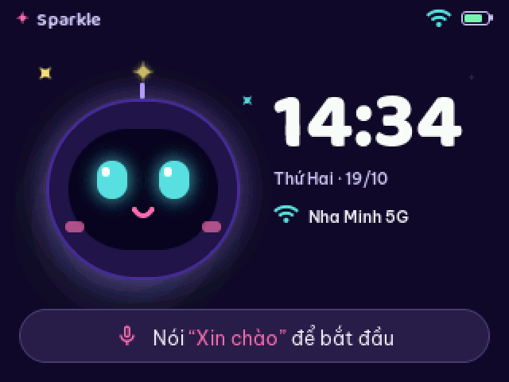
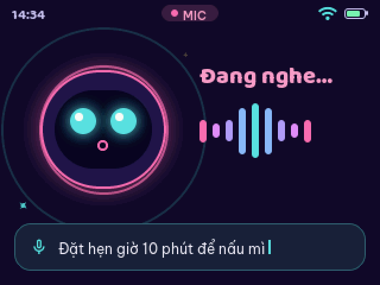
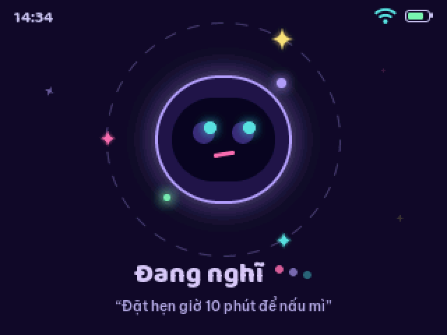
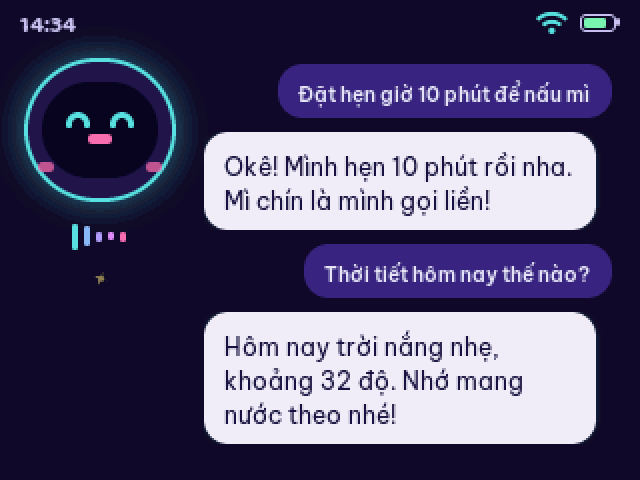
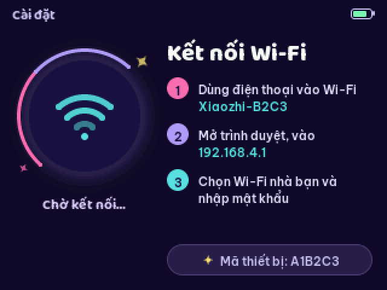

# ESP Chatbot – Sparkle Bot

Trợ lý giọng nói chạy trên **LCDWIKI ES3C28P** (ESP32-S3, màn 2.8" 320×240 nằm ngang),
dựa trên firmware [xiaozhi-esp32](https://github.com/78/xiaozhi-esp32).

| Chờ | Đang nghe | Đang nghĩ |
|:---:|:---:|:---:|
|  |  |  |

| Trả lời | Kết nối Wi-Fi |
|:---:|:---:|
|  |  |

## Build

```bash
docker run --rm -it -v "$PWD":/project -w /project -u $(id -u):$(id -g) -e HOME=/tmp \
  espressif/idf:release-v6.1 python scripts/build.py lcdwiki-es3c28p --language vi-VN
```

Chi tiết phần cứng và giao diện: [main/boards/lcdwiki-es3c28p](main/boards/lcdwiki-es3c28p/README.md).

## Giấy phép

MIT, giữ nguyên từ dự án gốc – xem [LICENSE](LICENSE).
